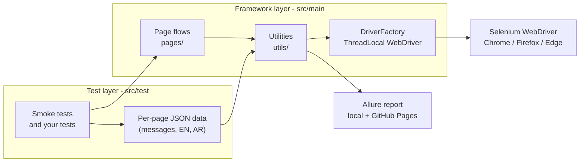
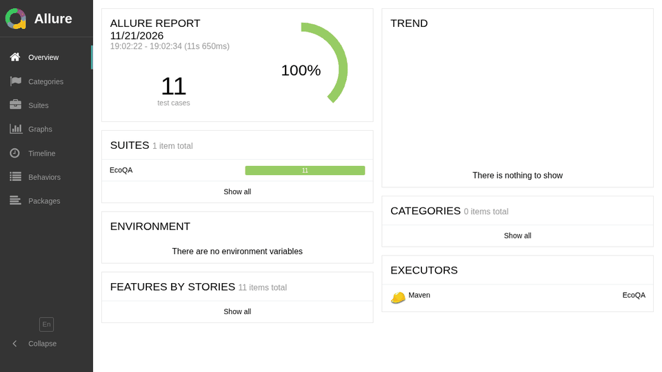
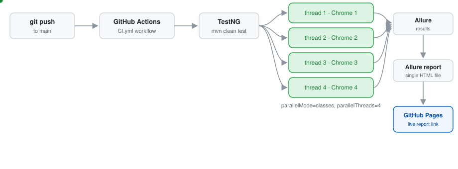
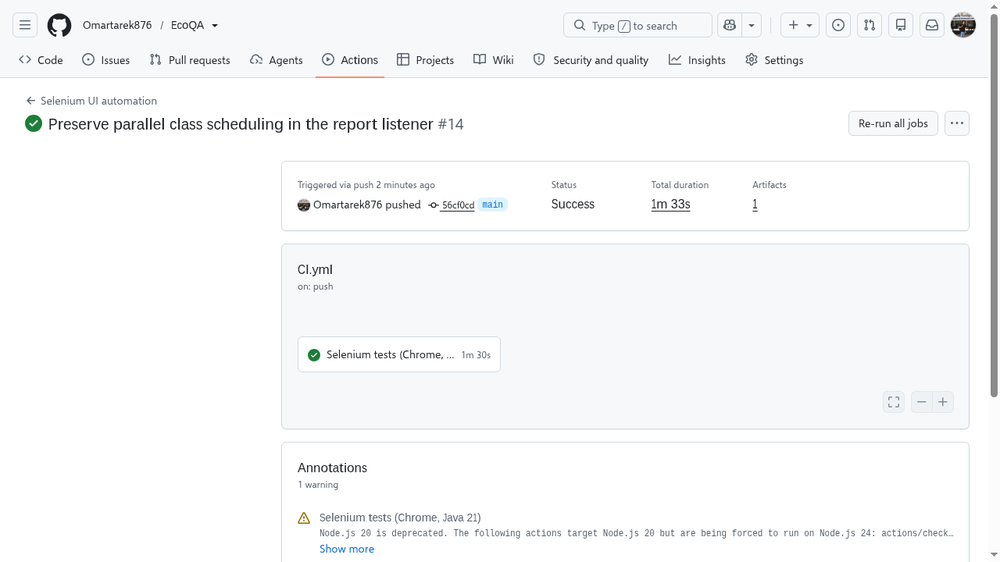
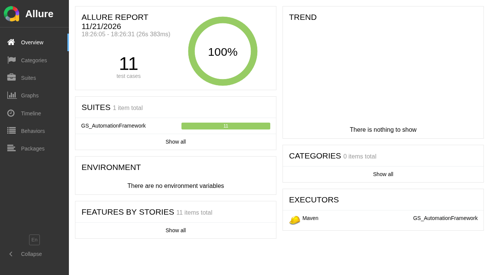
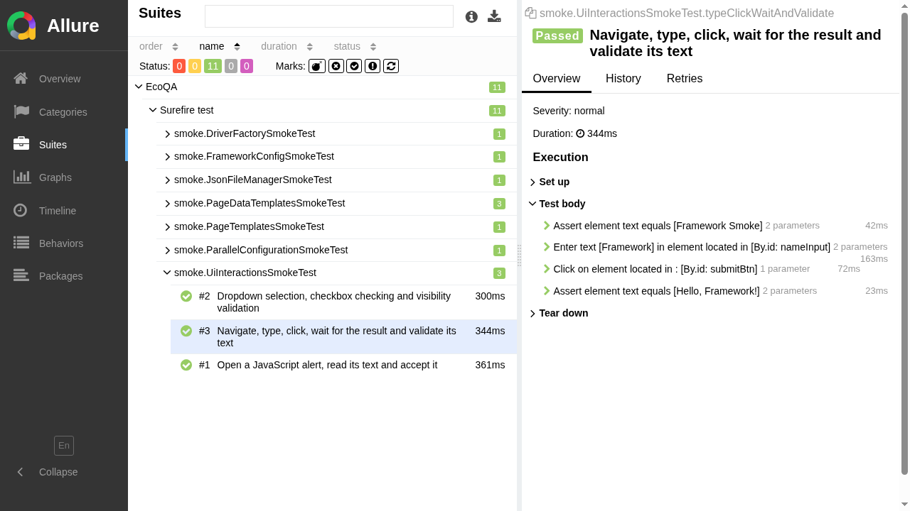
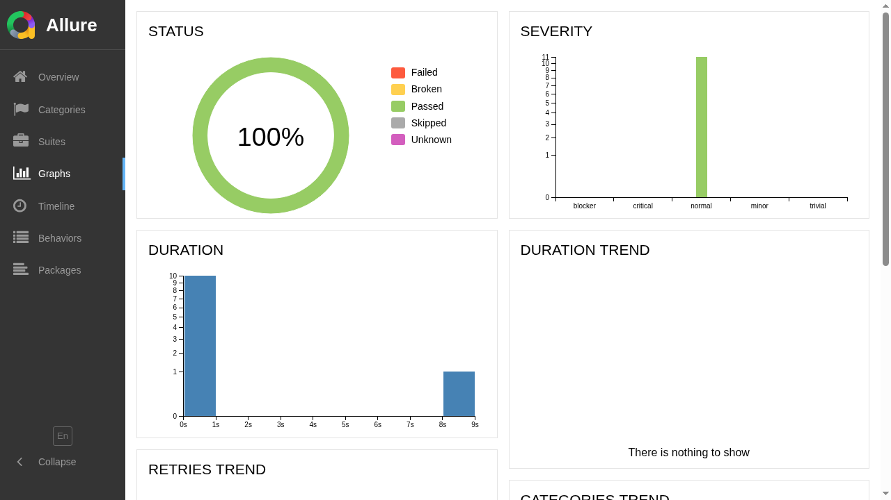

# EcoQA

A ready-to-use E2E test automation framework for e-commerce websites, built with
Selenium 4, TestNG and Allure reporting, with a plug-and-play GitHub Actions CI.
Drop in your store's URL, fill the page locators, and the common flows every
e-commerce site needs are ready to run: login, product search, add to cart,
cart management and checkout.

[](https://github.com/Omartarek876/EcoQA/actions/workflows/CI.yml)
[](https://omartarek876.github.io/EcoQA/)


[Structure](#framework-structure) · [Execution flow](#what-happens-on-every-push) · [Quick start](#use-it-on-your-store) · [Parallel execution](#parallel-execution) · [Live report](https://omartarek876.github.io/EcoQA/)

## Framework structure

```
EcoQA/
├── .github/workflows/CI.yml    plug-and-play pipeline: test, report, publish
├── src/main/java/
│   ├── pages/                  ready e-commerce page flows, locators to fill
│   └── utils/                  DriverFactory, element actions, waits,
│                               listeners, retry, Allure helpers
├── src/main/resources/
│   ├── environment.properties  baseUrl of the store under test
│   ├── execution.properties    browser, headless, waits, retry attempts
│   └── allure.properties       Allure results directory and suite name
├── src/test/java/
│   ├── smoke/                  framework self-tests, run in parallel in CI
│   └── templates/              copy-ready test class template
├── src/test/resources/
│   └── <Page>Page_Data/        messages + EN/AR data files per page
└── docs/                       screenshots, GIFs and diagrams for this README
```

How the layers connect:



Page-based tests call the page flows, which use the shared utilities for
driver access, waits, assertions and reporting. Per-page JSON files keep
site-specific data separate from test logic.



*A looping tour assembled from real report screenshots: overview, suites,
a passing test with its Allure steps, graphs and timeline. This is report
navigation, not a recording of browser test execution.*

## What happens on every push



*Illustration of parallel UI work. Browser sessions are created by UI tests as
needed, not reserved for every worker. The current smoke suite also has non-UI checks.*

1. A push to `main` (or a pull request) triggers `.github/workflows/CI.yml`.
2. The workflow sets up Java 21 and runs `mvn clean test`.
3. TestNG runs the test classes in parallel (see
   [Parallel execution](#parallel-execution)): each class stays on one worker
   from a pool of up to four workers. UI tests create isolated browser
   sessions through the thread-local `DriverFactory`; non-UI checks need no browser.
4. Allure records annotated steps. The listener attaches a failure screenshot
   when a browser session is available.
5. CI generates a single-file HTML report and uploads the artifact. Non-PR
   runs publish it to GitHub Pages, so the report is one link away:
   <https://omartarek876.github.io/EcoQA/>.

## Tech stack

- Java 21, Maven
- Selenium WebDriver 4.52 (Chrome, Firefox, Edge)
- TestNG
- Allure (allure-testng 3.0) for HTML reports
- GitHub Actions CI

## What's inside

### Ready e-commerce page flows - `src/main/java/pages/`

<details>
<summary>Page-flow catalog and setup notes</summary>

Each page class carries the methods any e-commerce site needs, written on top of
the framework utilities with Allure step reporting. The locators are intentionally
empty: fill them for your site and the flows work as-is.

| Class | Ready flows |
| --- | --- |
| `LoginPage` | enter credentials, submit, full `login(email, password)` flow, login error validation |
| `RegisterPage` | registration form, full `register(name, email, password)` flow, registration error validation |
| `ForgotPasswordPage` | full `requestPasswordReset(email)` flow, reset confirmation validation |
| `HomePage` | open the store from the configured `baseUrl`, product search, navigation to login/products/cart |
| `ProductsPage` | list and read products, open product details, add product to cart |
| `SearchResultsPage` | read and count results, sort results, open product details, add to cart from results |
| `ProductDetailsPage` | product name/price, quantity and size selection, add to cart, add to wishlist |
| `CartPage` | read cart items, update quantities, remove items, cart total, proceed to checkout |
| `CheckoutPage` | shipping address, payment method selection, place order, order confirmation validation |
| `PaymentPage` | card details, confirm payment, payment error validation |
| `OrderConfirmationPage` | confirmation message, order number, order confirmation validation, continue shopping |
| `OrdersPage` | order history list, numbers and statuses, order details, reorder items |
| `AccountPage` | profile read/update, add address, navigation to orders and wishlist, update validation |
| `WishlistPage` | wishlist items, move to cart, remove from wishlist, empty check |
| `ContactPage` | contact form, full `sendMessage(...)` flow, success validation |


</details>

### Framework utilities - `src/main/java/utils/`

<details>
<summary>Utility reference</summary>

| Class | Purpose |
| --- | --- |
| `DriverFactory` | Thread-local WebDriver management; browser, headless and window settings come from configuration |
| `PropertiesReader` | Loads `environment.properties` and `execution.properties` into system properties (command-line `-D` values win) |
| `ElementActions` | Safe element interactions (click, type, select) with explicit waits |
| `WaitUtils` | Explicit-wait helpers built on the configured timeout |
| `BrowserUtils` | Navigation and browser-level actions |
| `AlertActions` | Alert accept/dismiss/read helpers |
| `Validations` | Assertion helpers with Allure step reporting |
| `JsonFileManager` | Reads test data from JSON files with JSONPath queries |
| `TestNgListener` | TestNG listener: suite/test lifecycle hooks and Allure report generation after the suite |
| `RetryAnalyzer` | Decides whether a failed test gets another attempt (see Automatic retry below) |
| `RetryListener` | Attaches `RetryAnalyzer` to every test method automatically, no per-test changes |
| `AllureReportGenerator` | Runs `mvn allure:report` and opens the generated HTML report locally |


</details>

### Configuration - `src/main/resources/`

- `execution.properties` - run defaults: browser, headless, window maximize, wait timeout
- `environment.properties` - set `baseUrl` to your store under test
- `allure.properties` - Allure reporting: results directory and suite name

### Per-page test data - `src/test/resources/<Page>Page_Data/`

Every page template ships with its own data folder holding three JSON files:

- `<Page>Messages.json` - expected assertion messages, kept in their own file
  for readability
- `<Page>Data_EN.json` - English test data
- `<Page>Data_AR.json` - Arabic data, for sites that have a localized version

Files ship with `TODO: fill per site` placeholders grouped by field and scenario
(valid, empty, invalid, ...). The English and Arabic files always share the same
keys, and a smoke test enforces that.

Tests consume the files through `JsonFileManager`, the same pattern used in
production suites: declare the files as fields, load them in `@BeforeClass`
(the data language is selected with the `language` system property,
`-Dlanguage=AR`, defaulting to EN), and read values inside the fluent page
calls with JSONPath:

```java
@BeforeClass
public void setup() {
    loginMessages = new JsonFileManager("src/test/resources/LoginPage_Data/LoginMessages.json");
    loginData = new JsonFileManager("src/test/resources/LoginPage_Data/LoginData_"
            + System.getProperty("language", "EN") + ".json");
}

new LoginPage()
        .enterEmail(loginData.getTestData("$.credentials.validEmail"))
        .enterPassword(loginData.getTestData("$.credentials.validPassword"))
        .clickLoginButton();
```

A ready-to-copy class showing the full pattern lives at
`src/test/java/templates/PageTestTemplate.java`.

### Automatic retry for flaky tests

UI suites against live sites always have some flaky tests: the site is slow, an
element renders late, and an otherwise correct test fails for environmental
reasons. The framework retries these automatically:

- `RetryAnalyzer` (`src/main/java/utils/RetryAnalyzer.java`) implements
  TestNG's `IRetryAnalyzer`. When a test fails, it decides whether the test
  gets another attempt.
- `RetryListener` (`src/main/java/utils/RetryListener.java`) implements
  `IAnnotationTransformer` and attaches the analyzer to every test method, so
  no test class needs any annotation or code change. A test that declares its
  own retry analyzer keeps it.
- The maximum number of attempts is configurable: `maxTestAttempts` in
  `src/main/resources/execution.properties` (default `2`, meaning one retry
  after the first failure). Override it per run with
  `mvn clean test -DmaxTestAttempts=3`.

Both listeners are registered once in `pom.xml` next to `TestNgListener`, so
retrying works for the whole suite out of the box. Every attempt stays visible
in the results: TestNG reports the retried runs, and Allure keeps the failed
attempts with their screenshots next to the final result, so a flaky pass never
hides that a retry happened.

### Parallel execution

Test classes run in parallel out of the box, wired in `pom.xml` (no `testng.xml`
needed):

- `<parallelMode>` defaults to `classes`: every test class gets its own TestNG
  thread, while the methods inside a class always run sequentially. This is the
  safer default for classes with ordered or stateful flows, provided different
  classes do not share mutable state.
- `<parallelThreads>` defaults to `4`, a sensible size for a standard CI runner.
- `DriverFactory` keeps the browser in a `ThreadLocal`; tests must create and
  close their own session through the factory, as the templates do.
- `TestNgListener` keeps the classes in the same TestNG test block when parallel
  class/method execution is enabled, rather than splitting them for report
  naming. This lets TestNG actually schedule different classes together.

Tune both per run without editing the pom, for example
`mvn clean test -DparallelThreads=8` or `mvn clean test -DparallelMode=methods`
to parallelize the methods inside each class as well.

Rules for keeping tests parallel-safe:

1. Every test manages its own browser through `DriverFactory` (the templates
   already do) and never shares a driver between tests.
2. No shared mutable fields between test methods: anything one method writes and
   another reads (created accounts, cart contents, order ids) ties them to
   sequential order. Keep that state local to the method, or keep the class on
   sequential methods, which the default `classes` mode already guarantees.
3. Use unique test data per run (timestamped emails and names), so two threads
   or two CI runs never fight over the same account on the site under test.
4. Never share files or folders between parallel tests (downloads, screenshots,
   temp files); give each test its own path.
5. Review every class before switching to `-DparallelMode=methods`, including
   read-only tests: browser fields, setup/teardown, dependencies and shared
   fixtures must all be safe across threads. Account-creating and order-placing
   flows also need isolated server-side data.

### Smoke tests - `src/test/java/smoke/`

Verify the framework itself: configuration loads correctly, `DriverFactory`
starts a headless session, the core UI utilities work end to end against a local
page (navigation, typing, clicking, waits, validations, form controls, alerts),
`JsonFileManager` reads test data, every e-commerce page template constructs
cleanly with its empty locators, and every page's data folder is complete and
consistent across languages. No external site needed.

## Use it on your store

1. Clone this repository.
2. Set `baseUrl` in `src/main/resources/environment.properties` to your store.
3. Fill the page locators in `src/main/java/pages/` and the page data files in
   `src/test/resources/<Page>Page_Data/` (each is marked `TODO: fill per site`).
4. Add your tests under `src/test/java/` using the ready page flows.
5. Run with `mvn clean test`. Override configuration from the command line when needed,
   for example `mvn clean test -Dbrowser=firefox -Dheadless=false`.
6. Generate the report with `mvn allure:report`; it lands in `target/allure-report/`.

## CI

`.github/workflows/CI.yml` runs the suite on every push to `main`, pull request
and manual trigger: it sets up Java 21, runs `mvn clean test`, generates the Allure
report when results exist, uploads the test results and report as build artifacts
(kept for 14 days), and publishes the report to GitHub Pages (see below). No
project-specific values are hardcoded, so the workflow works unchanged for any
store that adopts this framework.



## Allure reporting

Reports are generated automatically after the suite runs. No reporting code is
needed in individual tests:

1. **During the run**, the Allure TestNG integration writes test results to
   `target/allure-results/`. The framework listener attaches a screenshot when
   a test fails and a browser session is available.
2. **After the suite**, `TestNgListener` calls `AllureReportGenerator`, which
   runs `mvn allure:report` and writes `target/allure-report/index.html`.
   On a desktop with browser support, it also tries to open the report.
   Maven must be available on `PATH` for this automatic step.
3. **In CI**, the workflow generates the report again and publishes it through
   two channels, so you pick whichever you prefer:

   **Option 1 - live GitHub Pages link.** After every run on `main`, the report
   is published to the `gh-pages` branch and served at
   <https://omartarek876.github.io/EcoQA/>, open it from any device, no downloads.
   One-time setup for a fresh copy of this framework: run the CI once (it creates
   the `gh-pages` branch), then in the repository Settings -> Pages choose
   "Deploy from a branch" with `gh-pages` / `(root)`.

   **Option 2 - downloadable artifact.** Every run uploads `ui-test-results` as a
   build artifact (kept for 14 days). Open a completed Actions run, download it,
   unzip it, and open `allure-report/index.html`. The report is configured as a
   single HTML file and includes its data.

To regenerate a report locally, run `mvn allure:report`. To serve the latest
results in your browser, run `mvn allure:serve`.

What the report looks like for this framework's smoke suite:



A passing test with its recorded steps, exactly as the page flows report them:



Status, severity and duration graphs:


