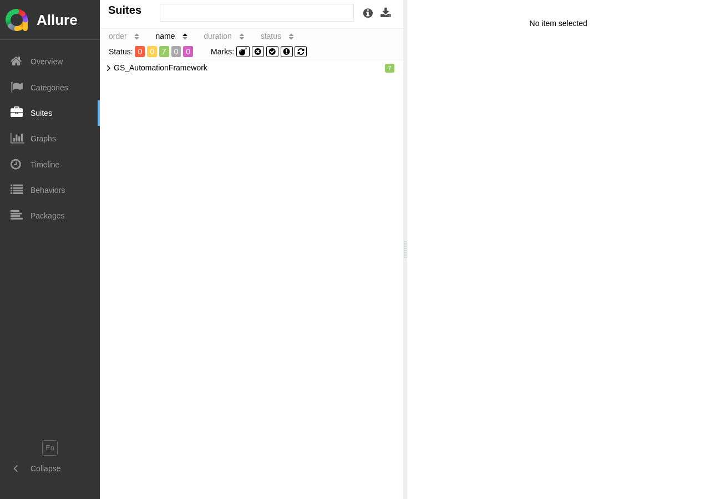

# EcoQA

A ready-to-use E2E test automation framework for e-commerce websites, built with
Selenium 4, TestNG and Allure reporting, with a plug-and-play GitHub Actions CI.
Drop in your store's URL, fill the page locators, and the common flows every
e-commerce site needs are ready to run: login, product search, add to cart,
cart management and checkout.

## Tech stack

- Java 21, Maven
- Selenium WebDriver 4.52 (Chrome, Firefox, Edge)
- TestNG
- Allure (allure-testng 3.0) for HTML reports
- GitHub Actions CI

## What's inside

### Ready e-commerce page flows - `src/main/java/pages/`

Each page class carries the methods any e-commerce site needs, written on top of
the framework utilities with Allure step reporting. The locators are intentionally
empty: fill them for your site and the flows work as-is.

| Class | Ready flows |
| --- | --- |
| `LoginPage` | enter credentials, submit, full `login(email, password)` flow, login error validation |
| `RegisterPage` | registration form, full `register(name, email, password)` flow, registration error validation |
| `ForgotPasswordPage` | full `requestPasswordReset(email)` flow, reset confirmation validation |
| `HomePage` | open the store from the configured `baseUrl`, product search, navigation to login/products/cart |
| `ProductsPage` | list and read products, open product details, add product to cart |
| `SearchResultsPage` | read and count results, sort results, open product details, add to cart from results |
| `ProductDetailsPage` | product name/price, quantity and size selection, add to cart, add to wishlist |
| `CartPage` | read cart items, update quantities, remove items, cart total, proceed to checkout |
| `CheckoutPage` | shipping address, payment method selection, place order, order confirmation validation |
| `PaymentPage` | card details, confirm payment, payment error validation |
| `OrderConfirmationPage` | confirmation message, order number, order confirmation validation, continue shopping |
| `OrdersPage` | order history list, numbers and statuses, order details, reorder items |
| `AccountPage` | profile read/update, add address, navigation to orders and wishlist, update validation |
| `WishlistPage` | wishlist items, move to cart, remove from wishlist, empty check |
| `ContactPage` | contact form, full `sendMessage(...)` flow, success validation |

### Framework utilities - `src/main/java/utils/`

| Class | Purpose |
| --- | --- |
| `DriverFactory` | Thread-local WebDriver management; browser, headless and window settings come from configuration |
| `PropertiesReader` | Loads `environment.properties` and `execution.properties` into system properties (command-line `-D` values win) |
| `ElementActions` | Safe element interactions (click, type, select) with explicit waits |
| `WaitUtils` | Explicit-wait helpers built on the configured timeout |
| `BrowserUtils` | Navigation and browser-level actions |
| `AlertActions` | Alert accept/dismiss/read helpers |
| `Validations` | Assertion helpers with Allure step reporting |
| `JsonFileManager` | Reads test data from JSON files with JSONPath queries |
| `TestNgListener` | TestNG listener: suite/test lifecycle hooks and Allure report generation after the suite |
| `AllureReportGenerator` | Runs `mvn allure:report` and opens the generated HTML report locally |

### Configuration - `src/main/resources/`

- `execution.properties` - run defaults: browser, headless, window maximize, wait timeout
- `environment.properties` - set `baseUrl` to your store under test

### Smoke tests - `src/test/java/smoke/`

Verify the framework itself: configuration loads correctly, `DriverFactory`
starts a headless session, the core UI utilities work end to end against a local
page (navigation, typing, clicking, waits, validations, form controls, alerts),
`JsonFileManager` reads test data, and every e-commerce page template
constructs cleanly with its empty locators. No external site needed.

## Use it on your store

1. Clone this repository.
2. Set `baseUrl` in `src/main/resources/environment.properties` to your store.
3. Fill the page locators in `src/main/java/pages/` (each is marked `TODO: fill per site`).
4. Add your tests under `src/test/java/` using the ready page flows.
5. Run with `mvn clean test`. Override configuration from the command line when needed,
   for example `mvn clean test -Dbrowser=firefox -Dheadless=false`.
6. Generate the report with `mvn allure:report`; it lands in `target/allure-report/`.

## CI

`.github/workflows/CI.yml` runs the suite on every push, pull request and manual
trigger: it sets up Java 21, runs `mvn clean test`, generates the Allure report when
results exist, and uploads the test results and report as build artifacts (kept for
14 days). No project-specific values are hardcoded, so the workflow works unchanged
for any store that adopts this framework.

## Allure reporting

Reports are generated automatically after the suite runs. No reporting code is
needed in individual tests:

1. **During the run**, the Allure TestNG integration writes test results to
   `target/allure-results/`. The framework listener attaches a screenshot when
   a test fails and a browser session is available.
2. **After the suite**, `TestNgListener` calls `AllureReportGenerator`, which
   runs `mvn allure:report` and writes `target/allure-report/index.html`.
   On a desktop with browser support, it also tries to open the report.
   Maven must be available on `PATH` for this automatic step.
3. **In CI**, the workflow also has an explicit report-generation step when
   results exist, followed by an artifact upload. Open a completed Actions run,
   download `ui-test-results`, unzip it, and open `allure-report/index.html`.
   The report is configured as a single HTML file and includes its data.

To regenerate a report locally, run `mvn allure:report`. To serve the latest
results in your browser, run `mvn allure:serve`.

What the report looks like for this framework's smoke suite:

